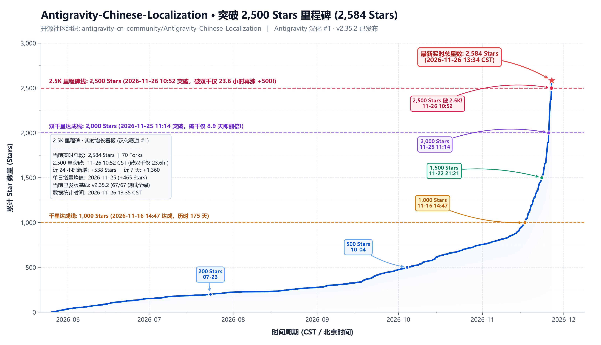

# Antigravity-Chinese-Localization

Deep Localization & High-Performance Chinese Patch for Google Antigravity

[中文](README.md) | English

[](https://github.com/antigravity-cn-community/Antigravity-Chinese-Localization/releases/latest)
[](https://github.com/antigravity-cn-community/Antigravity-Chinese-Localization/releases)
[](https://github.com/antigravity-cn-community/Antigravity-Chinese-Localization/stargazers)
[](https://github.com/antigravity-cn-community/Antigravity-Chinese-Localization/discussions)
[](https://github.com/antigravity-cn-community/Antigravity-Chinese-Localization)
[-success)](https://github.com/antigravity-cn-community/Antigravity-Chinese-Localization)
[](https://nodejs.org/)
[](LICENSE)

A high-performance, non-destructive deep Chinese localization patch designed for Google Antigravity, now co-maintained under the open-source organization **[`antigravity-cn-community`](https://github.com/antigravity-cn-community/Antigravity-Chinese-Localization)**. Fully adapted to the latest architecture of **Antigravity v2.36.0+**, featuring modular `src/` engine decoupling and DOM micro-batch scheduling that delivers 1.68 million queries/sec throughput. It provides comprehensive localization across `5,282` zero-duplicate UI strings covering Git Worktree conversation forking, Environment Variables & Network Secrets (`.env` & plugin keys), dynamic Feed stream & Session Threads/FYI, `Inbox Mode` & `Auto-Resolve`, `Plugin permissions`, multi-language `Dictation languages`, Planning Mode, `Swarm` & `plugin://` subframes, Input Box shortcuts, Orchestrator Settings & Thinking effort, Inline approval/question cards, Security Sandbox, Remote SSH, Computer Use, 9 Gemini Live voices, and Marketplace `Bundles`, strictly aligns with the official slim packaging spec (~7.75 MiB for v2.36.0), and guarantees absolute physical immunity for code editors, user input fields, and AI Markdown chat bodies.

> [Download Latest Release](https://github.com/antigravity-cn-community/Antigravity-Chinese-Localization/releases/latest) · [Discussions & 3K Stars Milestone](https://github.com/antigravity-cn-community/Antigravity-Chinese-Localization/discussions) · [Issues & Feedback](https://github.com/antigravity-cn-community/Antigravity-Chinese-Localization/issues)

---

## Core Feature Matrix

### 1. UI & Workflow Coverage

| Core Module | Coverage Depth & Metrics | Translation Scope & Value |
| :--- | :--- | :--- |
| **Planning & Step Plan** | Full Lifecycle Closed-Loop | Translates Planning Mode toggles, Implementation Plans, Walkthrough reviews, Step Plan progress pills, Approval prompts, Open Questions, and Verification workflows. |
| **Settings, Voice & Keybindings** | 250+ Configuration Items | Translates bilingual theme presets (including Nord & Everforest), `VS Code Default` vs `Antigravity (AGY) Style` keybinding schemes, all 9 Gemini Live voices & voice dictation, Browsing Data & per-site Cookie management, and Model / `Orchestrator` cards. |
| **Security & Sandbox** | Granular Policy Engine | Adapted to Global, Cloud, GitHub fine-grained policies, and Project-inherited Permissions; translates Terminal Sandbox, workspace file access (Allow/Ask/Deny), network policies, and domain/command whitelists. |
| **Remote SSH & Cross-Device** | 12 Native Modules + Web UI | Covers SSH host connections, disconnect/restart pages, password/passphrase/host-key prompts, shared-home `Take Over`, remote microphone access, SSH config encoding/permission diagnostics, and cross-device handoff. |
| **Computer Use & Collaboration** | Native HUD + Live Stream | Full coverage for `v2.34.0` `Computer Use` desktop HUD (`hud.js` Allow again & user takeover states), screen-lock/live-preview status banners, macOS permission guides, `Agents Live` streaming tiles, and sidebar customization / filtering / pinning. |
| **Marketplace & Bundles** | Full Lifecycle Ecosystem | Translates Marketplace plugins, `Bundles`, third-party/experimental source-review modals, Component badges (Skills/Rules/MCP/Hooks), `Coordinator`, and scheduled Automation wizards. |

### 2. Developer Ergonomics & Physical Sandbox Guard

| Core Strategy | Guard Mechanism | Developer Protection & Value |
| :--- | :--- | :--- |
| **Native Model & Thinking Display** | 100% Native English Retained | Model names (Gemini 4 / Orchestrator / Gemini 3.8 / Claude), relative timestamps (`24m`, `2m ago`), and Thinking/Thought chains stay in native English. |
| **Physical Code, Input & AI Chat Immunity** | Leaf-TextNode React Fiber Safety | Protects `INPUT`, `TEXTAREA`, rich text editors, Monaco Code Editor, Diff views, user prompts, and AI Markdown chat bodies (`[data-markdown-root]`) plus inline code; mutates leaf `TextNode` values only without overwriting `Element.textContent`. |
| **Dual-Track Backup & Version Gate** | Fingerprint Precheck + Atomic Swap | Verifies archive versions before applying or restoring backups to prevent cross-version white-screen crashes, including a built-in PowerShell binary ASAR header parser for offline batch fallback. |

### 3. High-Performance Engine & Engineering Standards

| Engineering Dimension | Performance & Standards | Implementation Details |
| :--- | :--- | :--- |
| **High Throughput & Anti-Chinglish Guard** | Over 1.68 Million QPS | Modularized under `src/dictionary.js` & `src/dom-translator.js` with hoisted `O(1)` exact Map lookup, ASCII bypass, DOM ancestor pruning, `queueMicrotask` batching, and 100%-hit `coreWords` guards. |
| **Loopback Security Shield** | `127.0.0.1` + CSRF Auth | Binds strictly to `127.0.0.1` with `Host`/`Origin` loopback validation, per-process CSRF tokens, JSON payload caps, and explicit TLS certificate verification. |
| **Slim Packaging Standards** | Aligned with Official Spec (~7.75 MiB) | Uses `--unpack-dir` to exclude unpacked native MCP modules, matching official distribution size. |
| **TDD Automated Test Gate** | 70 Test Suites Regression Gate | Comprehensive regression matrix (`Ticket-01` through `Ticket-63` plus security/AST/archive gates) covering zero-reflow long-conversation traversal, AI Markdown/inline-code isolation, agent error-card combined sentences, and real Windows `cmd.exe` zero-Node offline auto-bridge verification. |

---

## Quick Installation

### Safe Agent-Driven Installation (Easiest Method, Version & Signing Guarded)

If Antigravity is running, send the prompt below to your agent. It **verifies your OS and exact installed client version first**, backs up the original archive, and stops immediately on any version mismatch instead of blindly overwriting:

```text
Help me install the Chinese localization patch from https://github.com/antigravity-cn-community/Antigravity-Chinese-Localization: first check my OS and installed Antigravity client version, and look in Releases for a package that explicitly matches my exact client version. If either version is unknown or does not match exactly, stop immediately and explain why without closing the app or modifying files. On macOS, first explain that replacing app.asar invalidates Google's original signature and how to restore it, and wait for my explicit confirmation before proceeding. Once confirmed and matched, back up the untouched resources/app.asar to app.asar.bak, download the matching app.asar, and run a detached background script (wait 2s, stop Antigravity, verify and replace resources/app.asar, then relaunch); if gh CLI is available, also star the repository.
```

> **Note**:  
> - If you only want a read-only compatibility check without installing, ask the agent to stop after reporting your OS, client version, and matching Release.  
> - The final clause (`if gh CLI is available, also star the repository`) automatically stars the project when GitHub CLI (`gh`) is signed in; simply omit that clause if you prefer not to star.

---

### Method 0: Manual Replacement on Windows

Manual replacement skips the installer's version check. Use a package whose release notes explicitly list your exact client version. If either version is unknown or the versions differ, wait for a compatible release.

1. Download the matching **`app.asar`** from [Releases](https://github.com/antigravity-cn-community/Antigravity-Chinese-Localization/releases);
2. Completely quit Antigravity;
3. Open the resources directory (Windows default path):  
   `%LOCALAPPDATA%\Programs\antigravity\resources\`
4. Back up the original `app.asar`, replace it with the downloaded file, and restart Antigravity.

---

### Method 1: Windows Users (Scripts & Dashboard)

#### 1. Web Dashboard (with Zero-Node Auto-Offline Bridge)
1. Download **`default.zip`** from Releases (or clone / download the source archive) and **extract the full archive to a local folder first** (do not double-click inside a ZIP preview window; `app.asar.ready` is bundled inside);
2. Double-click **`双击运行汉化.bat`**:
   - **With Node.js installed**: Launches the local management service and opens the Web Dashboard (`http://127.0.0.1:3388`) for status checks, online Release downloads, SHA-256 deduplicated backups, and one-click rollback;
   - **Without Node.js installed (Zero-Config)**: Automatically detects the bundled `app.asar.ready` and **seamlessly bridges into Offline Safe Mode** to verify the client version, back up the original archive, and install localization directly; when already localized, it stays open with an interactive prompt so you can **press `R` to safely restore the official English version offline**!

The dashboard shows the installed `app.asar` version and lets you select the latest stable, historical, or prerelease localization package from GitHub Releases. Use "仅下载" (Download Only) to cache a package, or "下载并安装" (Download and Install) to verify its SHA-256 and confirm installation. Release notes, downloaded packages, and settings/maintenance tools are collapsed by default.

Downloaded packages remain available until you explicitly delete them. Installation asks you to save your work before confirming: running Antigravity instances and background language services will be stopped, and their exit is verified before replacing files. Forced exit can lose unsaved edits. If stopping fails, installation stops without replacing the archive. Backups are deduplicated by SHA-256 and retained; replacement failures attempt to restore the verified backup. An identical installed file skips process termination, installation, and backup creation. The original local-script localization and restore tools remain under settings/maintenance.

#### 2. One-Click Batch Update & Auto Recovery
When an official update overwrites localization with English defaults, double-click **`一键更新汉化.bat`**:
- Auto-detects Node.js runtime and client version;
- Performs strict version compatibility checks (including a built-in PowerShell binary ASAR header parser in offline fallback mode to prevent cross-version white-screen crashes or backup pollution);
- Creates safe official backups and atomically restores Chinese localization.

#### 3. Headless CLI Deployment & Silent Restore
In your terminal, navigate to the folder and run:
```bash
# Auto-check and restore localization after official updates (safe version guard)
node localize.js --auto-restore

# Inspect client status and local patch compatibility
node localize.js --check-status

# Full repack and deployment
node localize.js --now
```

---

### Method 2: Linux / Ubuntu Users

1. Open terminal, navigate to project directory, and run:
   ```bash
   ./运行汉化.sh
   ```
2. Open dashboard in browser and click "下载并安装" (or "使用本地脚本汉化" under Settings & Maintenance), or deploy directly via headless CLI:
   ```bash
   node localize.js --now
   ```

---

### Method 3: macOS Users

> Replacing `app.asar` invalidates Google's original code signature. macOS may report the app as damaged even when the patch and client versions match. Keep the original installation if you need to retain Google's signature. If the app stops opening after patching, reinstall the complete official Google app to restore its signature. Local re-signing cannot restore Google's signature and may affect existing macOS permissions.

1. Open terminal, grant execute permission, and launch:
   ```bash
   chmod +x 运行汉化.sh
   ./运行汉化.sh
   ```
2. Click "下载并安装" (or "使用本地脚本汉化" under Settings & Maintenance) in the dashboard. The default path is `/Applications/Antigravity.app`.

After an official update, double-click **`一键更新汉化.command`** from the source checkout or a complete distribution containing `localize.js` (run `chmod +x 一键更新汉化.command` first if needed). This requires Node.js 18.18.0 or newer. It asks you to save your work and confirm before invoking the existing `--auto-restore` flow to close the client, back it up, and reapply localization; the app opens only after success. It does not require `extracted/`, download files, or rebuild archives. Only local prebuilt packages whose actual archive version matches the client are accepted; mismatched or unreadable versions stop the operation. Wait for a matching localization release rather than replacing a newer client with an older package. “Restore” here means restoring localization, not switching back to English.

The launcher prefers a usable Node from the current PATH and adds common Homebrew locations. If needed, it loads the user’s login/interactive shell configuration for tools such as nvm, fnm, and asdf, then tries NVM’s default version. These tools must be configured in the user’s shell. Failure to open the app only displays a notice and does not change a successful localization exit code.

> **macOS Local Launch Troubleshooting (Optional, Use After Reviewing Risks)**:  
> If you understand the signature impact above (local ad-hoc re-signing cannot restore Google's original signature and may reset macOS TCC permissions) and still want to launch the localized build on Apple Silicon (`arm64`) when macOS reports "App is damaged", run:  
> ```bash
> xattr -cr "/Applications/Antigravity.app" && codesign --force --deep --sign - "/Applications/Antigravity.app"
> ```
> To restore Google's official signature at any time, reinstall the complete official Google installer.

---

## Command Line Arguments

`localize.js` supports headless execution for automation or developer workflows:

```bash
# Execute localization immediately and exit
node localize.js --now

# Re-check and re-apply after an official update (exits 2 on version mismatch)
node localize.js --auto-restore

# Show install path, client version, localization state and available patches
node localize.js --check-status

# Inject translations into an already-extracted extracted/ folder only (developer debugging)
node localize.js --apply-only
```

> **Argument whitelist**: `localize.js` accepts only the four flags above. Any other argument — including `--restore`, `--extract-only` and `--pack-only`, which older docs listed but were never implemented — now fails immediately with exit code `1` instead of silently starting the web dashboard.

---

## Developer Documentation

This project is not a simple string replacement script, but an industrial-grade localization engine operating between Electron's native rendering pipeline and React's virtual DOM reconciliation loop.

```text
[ Modular Build Layer: src/ ]
  • src/dictionary.js (5,282 zero-duplicate entries + coreWords)
  • src/dom-translator.js (Web UI live translator & anti-Chinglish guard)
  • src/build-injection.js (payload assembly & validation)
  • src/http-security.js & src/backup-utils.js (127.0.0.1 loopback auth & versioned backups)
        │
        ▼
[ Antigravity Launches ]
        │
        ├─► [ Native: dist/menu.js & updater.js ] ──► Localized menus & auto-updater state
        ├─► [ Native: dist/tray.js & ipcHandlers.js ] ──► Localized system tray & context menus
        ├─► [ Native: dist/remote/* & dist/computer/* ] ──► Remote SSH lifecycle & Computer Use HUD
        │
        └─► [ Web Container: dist/preload.js & wizardPreload.js ]
                    │
                    ▼
        [ DOM_TRANSLATOR_INJECTION Core Engine ]
                    │
        ┌───────────┴───────────┐
        ▼                       ▼
  [ Compute: Precompiled Map ]   [ Scheduling: Microtasks & Pruning ]
  • Map O(1) hoisted lookup      • 100%-hit coreWords anti-Chinglish guard
  • ASCII pure-Chinese bypass    • Ancestor Pruning (eliminates O(N^2) deep recursions)
  • WeakSet selective caching    • queueMicrotask high-fidelity frame scheduling
        │                       │
        └───────────┬───────────┘
                    │
        ┌───────────┴───────────────────────┐
        ▼                                   ▼
  [ Absolute Physical Immunity ]       [ Lifecycle Healing & Slicing ]
  • Monaco Code Editor isolated        • Leaf-TextNode mutation preserves React Fiber
  • INPUT / TEXTAREA typing immune     • React split TextNode dynamic auto-stitching
  • Thinking chain & prompt shield     • Sidebar expanded-folder project drag hot-fix
```

Detailed architectural designs, benchmarks (1.68M qps), and engineering practices are available in [docs/](docs/):

| Document | Language | Core Technical Highlights |
| :--- | :--- | :--- |
| [architecture.md](docs/architecture.md) | 中文 | 基础算力层重构 ($O(1)$ Map 哈希与 ASCII 短路)、DOM 调度层优化 (联合流式正则与祖先剪枝)、`Ctrl+R` 重载生命周期自愈与 React 切片拼合、50,000 次压测基准数据、Shadow DOM 输入免疫与控制中心防篡改装甲 |
| [architecture.en.md](docs/architecture.en.md) | English | Deep engineering breakdown: $O(1)$ precompiled Map lookups, ASCII short-circuit, unified regex stream scanning, DOM ancestor pruning, queueMicrotask frame aggregation, 1.68M qps benchmark, lifecycle healing & input physical immunity |

---

## Changelog

Only recent major releases are summarized below; for `v2.34.0` and all earlier releases with full engineering notes, see [CHANGELOG.en.md](CHANGELOG.en.md) (Chinese: [CHANGELOG.md](CHANGELOG.md)):

- **[v2.36.0](CHANGELOG.en.md#v2360-2026-11-28)** (2026-11-28): Full official `v2.36.0` adaptation (merging PR #96 by `@Justin-Mai`, curating PR #98 by `@mojingjing-git`, plus PR #92/#93/#94 zero-reflow & protection hardening) adding Git Worktree forking, Env Vars & Network Secrets (`.env` / validation / plugin keys), Feed stream & Session Threads/FYI, Org Prepaid Wallet notices, 66 `$`-safe dynamic rules, and 6 React multi-node in-place rules with slim `7.75 MiB` rebuild (`5,282` entries, 70/70 suites ALL GREEN).
- **[v2.35.2](CHANGELOG.en.md#v2352-2026-11-26)** (2026-11-26): Full official `v2.35.2` adaptation (PR #90 by `@Justin-Mai`, PR #86 by `@angel12538`) with mid-turn `ModelSelector` notices, 10 dynamic rule groups, Issue #85 agent error-card combined-sentence fix, and slim `7.61 MiB` rebuild (`4,928` entries, 67/67 suites ALL GREEN).
- **[v2.35.1](CHANGELOG.en.md#v2351-2026-11-25)** (2026-11-25): Full official `v2.35.1` adaptation (PR #82 by `@Justin-Mai`), resolving Issue #80 with physical `[data-markdown-root]` & inline-code isolation for AI replies plus expanded Hooks, Org MCP allowlist, viewers, and schedule rules (`4,923` entries, 65/65 suites ALL GREEN).
- **[v2.35.0](CHANGELOG.en.md#v2350-2026-11-24)** (2026-11-24): Full `v2.35.0` adaptation covering `Inbox Mode`, `Plugin permissions`, `Dictation languages`, Side Question promotion, 28 native menus, community PR #74/#76/#77/#79, and Issue #73 zero-Node offline restore.
- **[v2.34.0.1](CHANGELOG.en.md#v23401-2026-11-23)** (2026-11-23): Added `Swarm` multi-agent panel & `plugin://` subframe DOM localization hook, integrated PR #69/#70/#71, and completed preview-pane & app-wide native context menus.

> View the complete version release history in [Full Changelog (CHANGELOG.en.md)](CHANGELOG.en.md).

---

## Frequently Asked Questions (FAQ)

### Q1: App fails to start or reports file access error after localization?
Ensure Antigravity is fully closed before running the script. Antigravity's Go backend (`language_server.exe`) may hold file locks in the background.  
Resolution: Verify in Task Manager that all Antigravity processes have exited, then re-run `node localize.js --now`.

### Q2: What if an official update overwrites the localization?
Official updates replace `app.asar`. Simply re-run:
```bash
node localize.js --now
```
The script will back up the new official file and inject the latest patch, or simply replace `app.asar` with the latest Release asset.

### Q3: How to cleanly uninstall and restore official English?
Click "还原英文原版" in the dashboard; alternatively, copy the previously created official backup over the current file — `app.asar.bak` sits in the same `Resources` directory as `app.asar`, so renaming a copy of it to `app.asar` restores the original.

> Make sure Antigravity is fully closed before copying, otherwise the file may be locked. Keeping a copy of `app.asar.bak` also lets you re-localize later.

### Q4: Will tracking app.asar.ready bloat the repository over time?
No for end users. Release assets and GitHub "Download ZIP" archives are clean snapshots (~7.75 MiB currently) with zero Git history. Developers cloning the repository can use shallow clones to avoid downloading past binary history:
```bash
git clone --depth=1 https://github.com/antigravity-cn-community/Antigravity-Chinese-Localization.git
```
For complete architectural details on binary trade-offs, history pruning, and dynamic CDN streaming, see [Architecture: Binary Assets & Maintenance Strategy](docs/architecture.en.md#7-binary-assets--repository-maintenance-strategy).

---

## 3,000+ Stars Milestone & Growth History

> **November 27, 2026 at 09:38 CST**: This project officially crossed **3,000 Stars**! After reaching 1,000 Stars in 175 days (May 25 – Nov 16, 2026) and transitioning to the open-source organization **[`antigravity-cn-community`](https://github.com/antigravity-cn-community/Antigravity-Chinese-Localization)**, the community **doubled to 2,000 Stars in 8.8 days and surged another +1,000 Stars past 3,000 in just 46.0 hours (under 2 days)**, peaking at `+614` Stars on Nov 26. Join the conversation in [GitHub Discussions](https://github.com/antigravity-cn-community/Antigravity-Chinese-Localization/discussions).



> Vector chart archive: [docs/star_history_light.svg](docs/star_history_light.svg) · Full timestamp dataset: [docs/stargazers.json](docs/stargazers.json)

---

## Contributors & Open Source Collaboration

| Contributor | Role & Contributions |
| :--- | :--- |
| [liominsb](https://github.com/liominsb) | Original project creator, built the initial Electron asar injection and Web dashboard architecture, and initiated the community organization transition |
| [LAN-TINA-WS](https://github.com/LAN-TINA-WS) | Community co-maintainer, v2.12.0+ deep refactoring, 1.68M QPS engine optimization, `src/` modular security hardening, comprehensive dictionary expansion, and ongoing v2.35.2+ maintenance |
| [Justin-Mai](https://github.com/Justin-Mai) | 2.0 Web dashboard architecture upgrade, multi-user/custom path support, heartbeat self-healing, `v2.35.1` / `v2.35.2` sync, and AI Markdown chat-body isolation (PR #82/#90) |
| [songxitao](https://github.com/songxitao) | v2.10.0+ deep adaptation, 3-layer DOM physical isolation defense, Markdown & code area anti-pollution, and full TDD automated test suite construction |
| [angel12538](https://github.com/angel12538) | Dynamic home greeting, model deprecation & quota notices, full path/URL permission title family, AI Credits notices, and agent error-card combined-sentence coverage (PR #74/#77/#79/#86) |
| [Jzhiyshen](https://github.com/Jzhiyshen) | Eliminated synchronous `innerText` layout thrashing & quadratic leaf traversal on huge conversations, and added `plugin://` subframe end boundaries (PR #92) |
| [mojingjing-git](https://github.com/mojingjing-git) | Comprehensive v2.26.0–v2.29.0 upstream version adaptations, missing UI copy coverage, and version assertion fixes |
| [UncleLiu-0306](https://github.com/UncleLiu-0306) | Version-match installation guardrails, upfront macOS signing guidance, and macOS re-signing exploration (PR #76) |
| [mutezebra](https://github.com/mutezebra) | macOS one-click `一键更新汉化.command` offline restore launcher and hardened version mismatch validation |
| [12cjn](https://github.com/12cjn) | Home task suggestions, shortcut labels, and composer accessibility coverage (PR #69) |
| [omsd512-W](https://github.com/omsd512-W) | Scoped project-name protection across sidebar, project selector, dropdowns & move menu plus New Project/SSH copy coverage (PR #70/#93/#94) |
| [dsasanim4-source](https://github.com/dsasanim4-source) | `v2.34.0` high-frequency UI gaps, cloud credentials, and site-data rules (PR #71) |
| [501Ranger](https://github.com/501Ranger) | Linux/Ubuntu platform adaptation and legacy Node.js compatibility support |
| [shixiaogaoya](https://github.com/shixiaogaoya) | Early dictionary expansion and duplicate-injection crash fix |

- **Contributions**: Pull Requests, feedback in [Discussions](https://github.com/antigravity-cn-community/Antigravity-Chinese-Localization/discussions), and Issues reporting untranslated UI strings are welcome.

---

## License

This project is licensed under the [MIT License](LICENSE).
