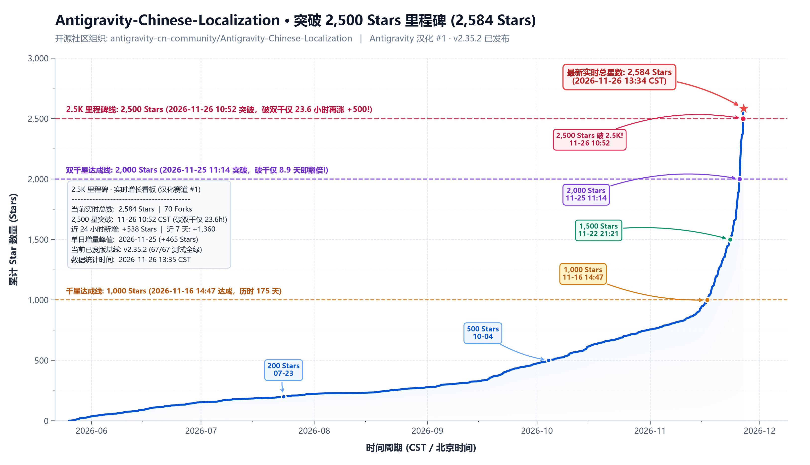

# Antigravity-Chinese-Localization

Antigravity 深度汉化与高性能本地化补丁程序

中文 | [English](README.en.md)

[](https://github.com/antigravity-cn-community/Antigravity-Chinese-Localization/releases/latest)
[](https://github.com/antigravity-cn-community/Antigravity-Chinese-Localization/releases)
[](https://github.com/antigravity-cn-community/Antigravity-Chinese-Localization/stargazers)
[](https://github.com/antigravity-cn-community/Antigravity-Chinese-Localization/discussions)
[](https://github.com/antigravity-cn-community/Antigravity-Chinese-Localization)
[-success)](https://github.com/antigravity-cn-community/Antigravity-Chinese-Localization)
[](https://nodejs.org/)
[](LICENSE)

专为 Google Antigravity 打造的高性能、非破坏性深度汉化补丁，现由开源社区组织 **[`antigravity-cn-community`](https://github.com/antigravity-cn-community/Antigravity-Chinese-Localization)** 联合维护。全面适配 **Antigravity v2.36.0+** 最新架构，完成 `src/` 模块化引擎解耦与 DOM 微任务调度重构，带来百万级吞吐量的极致流畅体验。全量汉化 Git Worktree 对话派生、环境变量与网络密钥管理、Feed 动态流与会话线程/FYI、收件箱模式 (`Inbox Mode`)、插件权限管理、语音听写多语言选择、规划模式、系统设置、安全沙盒、Remote SSH 远程开发、Computer Use 桌面操控与预览、内联审批/提问卡片、`Swarm` 多智能体侧栏与 `plugin://` 子框架、`Orchestrator` 模式设置与 `5,282` 条零重复核心界面文案，严格对齐官方原生轻量级打包规格（v2.36.0 约 7.75 MiB），并对用户打字、代码编辑区及 AI 对话 Markdown 正文实施绝对物理免疫。

> [最新 Release 下载](https://github.com/antigravity-cn-community/Antigravity-Chinese-Localization/releases/latest) · [社区讨论与三千星里程碑 (Discussions)](https://github.com/antigravity-cn-community/Antigravity-Chinese-Localization/discussions) · [问题反馈与建议](https://github.com/antigravity-cn-community/Antigravity-Chinese-Localization/issues)

---

## 核心特性矩阵

### 1. 全景交互与工作流深度汉化 (UI & Workflow Coverage)

| 核心模块 | 覆盖深度与技术指标 | 汉化范围与业务价值 |
| :--- | :--- | :--- |
| **规划模式与步骤计划 (Planning & Step Plan)** | 全生命周期闭环深度汉化 | 覆盖规划模式开关、实施计划 (Implementation Plan)、变更回顾 (Walkthrough)、Step Plan 步骤进度胶囊、审批阻断及待确认问题全套流程。 |
| **系统设置、语音与快捷键 (Settings & Voice)** | 250+ 设置项全景覆盖 | 覆盖双语配色主题（含 Nord / Everforest）、`VS Code Default` / `Antigravity (AGY) Style` 双模快捷键方案、Gemini Live 9 款音色与实时语音听写、浏览数据与按站点 Cookie 管理、以及模型配额与 `Orchestrator` 模式设置卡片。 |
| **安全与权限沙盒 (Permissions)** | 粒度精细化安全策略 | 适配全局权限、云端权限、GitHub 细粒度权限策略与项目继承架构，汉化终端沙盒、文件访问策略（允许/询问/拒绝）、网络策略及域名/命令黑白名单。 |
| **Remote SSH 与跨端协同** | 主进程 12 模块 + 前端联动 | 全面汉化 SSH 远程连接、断连/重启过渡页、密码/密钥口令/主机指纹弹窗、共享主目录冲突接管 (`Take Over`)、远程麦克风授权、SSH 配置文件编码/权限诊断及跨设备远程接力。 |
| **Computer Use 与多维协作** | 原生 HUD + 实时视频流窗格 | 全面覆盖 `v2.34.0` 升级后的 `Computer Use` 桌面操控 HUD (`hud.js` 停用/重新允许与接管状态)、锁屏及实时预览不可用提示、macOS 权限引导、`Agents Live` 视频流与多维侧栏自定义/筛选排序。 |
| **插件市场与组合包 (Marketplace & Bundles)** | 全生命周期生态管理 | 深度汉化扩展市场精选生态、`Bundles` 插件组合包、第三方/实验性插件安装前源码安全审查弹窗、构件标签（Skills/Rules/MCP/Hooks）及协调器 (`Coordinator`) 与定时自动化向导。 |

### 2. 专业开发哲学与物理安全装甲 (Ergonomics & Physical Sandbox)

| 核心策略 | 防护机制与实现方案 | 业务价值与开发者保障 |
| :--- | :--- | :--- |
| **模型与思考链原生保留** | 100% 保持官方英文原生 | 严格遵循专业开发习惯，模型名称（Gemini 4 / Orchestrator / Gemini 3.8 / Claude 等）、相对时间（`24m` / `2m ago`）及思考链（Thinking / Thought 过程）保留原生英文，杜绝机器硬翻歧义。 |
| **编辑器、输入与 AI 正文物理免疫** | 叶子节点级 React Fiber 安全 | 智能免疫 `INPUT`、`TEXTAREA`、富文本输入框、Monaco 代码编辑器、Diff 比对器、用户对话气泡以及 AI 回复 Markdown 正文（`[data-markdown-root]`）与行内代码；严格仅修改叶子 `TextNode` 而不覆写容器 `Element.textContent`，杜绝破坏 React Fiber 子树。 |
| **双轨备份与防白屏门禁** | 版本指纹预检 + 原子替换 | 部署前自动校验原版并维护版本匹配的官方备份，跨版本还原自动安全拦截防白屏；连离线批处理也内置了 PowerShell 二进制 ASAR 头解析预检。 |

### 3. 工业级底层算力与工程工艺 (High-Performance Engine & Engineering)

| 工程维度 | 性能指标与工程标准 | 底层技术实现 |
| :--- | :--- | :--- |
| **极致吞吐与防夹生守卫** | 吞吐量突破 168 万次/秒 | 模块化拆分为 `src/dictionary.js` 与 `src/dom-translator.js`，前置 `O(1)` 哈希精确查找、ASCII 纯中文短路、DOM 祖先剪枝、`queueMicrotask` 帧聚合及 `coreWords` 100% 实词命中防夹生守卫。 |
| **本机回环安全装甲** | `127.0.0.1` + CSRF 强鉴权 | 控制中心强制绑定 `127.0.0.1`，全接口实施 `Host`/`Origin` 回环校验、单进程一次性 CSRF Token 鉴权、JSON 请求体大小限制与显式 TLS 证书校验。 |
| **轻量打包与标准规格** | 严格对齐官方原生规格（约 7.75 MiB） | 使用 `--unpack-dir` 排除外部解包依赖，彻底消除历史版本体积膨胀问题，与官方原生分发包规格保持一致。 |
| **全套 TDD 自动化测试门禁** | 70 组测试套件全面回归校验 | 覆盖模块化翻译引擎、超长对话零回流遍历、词典零重复基线、AI 正文 Markdown/行内代码物理隔离、智能体错误卡片组合句、主进程功能沙盒、AST 语法门禁、回环安全鉴权、无 Node.js 实机批处理离线桥接及流式发布下载防护。 |

---

## 快速安装指南

本补丁提供多种灵活的安装方式，满足普通用户与开发者的不同场景需求：

### 智能体安全安装指令（最简模式，带版本与签名门禁）

如果 Antigravity 正在运行，可直接将下方指令发送给当前智能体；它会**先严格核对系统与本地客户端版本**，确认匹配并备份原版后再执行安全安装（版本不匹配立即停止，绝不盲目覆盖）：

```text
帮我安装 https://github.com/antigravity-cn-community/Antigravity-Chinese-Localization 的汉化补丁：请先检查当前操作系统和本机 Antigravity 的实际客户端版本，并在 Releases 查找明确支持该客户端版本的汉化包；若任一版本无法确认或不完全匹配，请立即停止并告知原因，不要关闭客户端或覆盖文件。如果是 macOS，请先向我说明替换 app.asar 会使 Google 原始代码签名失效及恢复方式，等我明确确认后再继续。确认版本完全匹配后，先为原版 resources/app.asar 创建纯净备份 app.asar.bak，再预先下载匹配版本的 app.asar 并编写独立后台脚本（延迟 2 秒、结束 Antigravity 进程、校验后覆盖 resources/app.asar 并重启客户端）分离执行；若有 gh CLI 请顺便为该开源项目标记 Star。
```

> **说明与提示**：  
> - 若只想先检查适配状态、暂不安装，可把后半段删掉，只让智能体汇报系统、本地版本与 Releases 匹配结果即可。  
> - 指令末尾包含 `若有 gh CLI 请顺便为该开源项目标记 Star`，已登录 GitHub CLI（gh）时会自动为本项目点 Star 支持维护；如不希望自动点 Star，复制时删掉该分句即可。

---

### 方式零：Windows 手动覆盖

手动覆盖会跳过安装工具的版本校验。仅使用发布说明明确支持当前客户端版本的预制包。版本未知或不完全匹配时，请等待适配。

1. 前往 [Releases](https://github.com/antigravity-cn-community/Antigravity-Chinese-Localization/releases) 下载匹配版本的 **`app.asar`**；
2. 彻底退出正在运行的 Antigravity；
3. 打开程序目录（Windows 默认位置）：  
   `%LOCALAPPDATA%\Programs\antigravity\resources\`
4. 备份原始 `app.asar`，再用下载的文件覆盖并重新启动 Antigravity。

---

### 方式一：Windows 用户（脚本与控制中心）

#### 1. 图形化控制中心（支持无 Node.js 自动离线桥接）
1. 下载 Release 发布的 **`default.zip`**（或直接 clone 仓库 / 下载源码包），**先完整解压到本地文件夹**（请勿直接在压缩包预览窗口内双击运行；压缩包内已自带 `app.asar.ready`）；
2. 双击运行目录下的 **`双击运行汉化.bat`**：
   - **已安装 Node.js 环境**：自动启动本地管理服务并在默认浏览器打开可视化控制中心（`http://127.0.0.1:3388`），支持状态检测、在线拉取历史/最新 Release 补丁、备份去重与一键还原；
   - **未安装 Node.js 环境（开箱即用）**：自动识别同目录下的 `app.asar.ready`，**无缝切换至【离线安全模式】**直接校验客户端版本并完成安全备份与汉化部署；若客户端已汉化，脚本会停留在交互提示中并支持**直接输入 `R` 离线安全还原官方英文原版**，无需手动折腾运行环境！

控制中心首页显示实际已安装的 `app.asar` 版本，可以直接读取 GitHub Releases，选择最新正式版或历史版本。“仅下载”将文件缓存到本项目的 `downloads/` 目录；“下载并安装”在下载和 SHA-256 校验后，确认安装到配置的目标路径。更新说明和已下载版本默认折叠；路径配置、本地脚本汉化、还原及日志可在“设置与维护”中展开。

各版本缓存会一直保留。用户可以在“已下载版本”列表中安装或单独删除某个缓存包；删除缓存不会修改 Antigravity 的安装文件。安装确认会提醒先保存编辑；用户确认后，如程序仍在运行，控制中心会结束所有 Antigravity 实例及后台语言服务，并严格确认进程退出后才备份和安装。强制退出可能丢失未保存的编辑；停止失败时不替换安装文件。替换失败会尝试恢复本次备份。备份按文件内容（SHA-256）去重，相同内容直接复用已有备份；当前安装文件已经与所选包一致时，跳过结束进程、安装和备份。不同内容的备份及历史备份会保留，不自动删除。“设置与维护”中的“使用本地脚本汉化”按钮继续提供本地解包注入流程。

#### 2. 一键快速更新与官方更新恢复（双击即用）
官方客户端自动更新后会还原为英文原版，此时双击运行 **`一键更新汉化.bat`**：
- 自动检测 Node.js 环境与客户端实际版本；
- 具备严格的版本兼容性校验（即使在未安装 Node.js 的离线保底模式下，也会通过内置 PowerShell 二进制解析器校验 ASAR 版本与汉化指纹，彻底防止跨版本覆盖白屏与备份污染）；
- 自动备份纯净官方原版并原子替换恢复汉化。

#### 3. 命令行极速部署与静默恢复（免开浏览器）
在终端中进入项目目录，执行以下命令：
```bash
# 官方更新后自动检查并恢复（匹配版本安全安装，不兼容则自动拦截）
node localize.js --auto-restore

# 查看客户端状态与本地补丁兼容性信息
node localize.js --check-status

# 直接全量重新打包并部署
node localize.js --now
```

---

### 方式二：Linux / Ubuntu 用户

1. 打开终端，进入项目目录，运行一键启动脚本：
   ```bash
   ./运行汉化.sh
   ```
2. 浏览器自动打开可视化控制面板，点击“下载并安装”（或在“设置与维护”中点击“使用本地脚本汉化”）。  
   或者直接通过无头命令行部署：
   ```bash
   node localize.js --now
   ```

---

### 方式三：macOS 用户

> 替换 `app.asar` 会使 Google 原始代码签名失效。即使汉化包与客户端版本完全匹配，macOS 也可能提示“应用已损坏，无法打开”。需要保留官方签名时，请保留原版。若替换后无法启动，可用 Google 官方完整安装包覆盖安装，恢复官方签名。本地重签无法恢复 Google 签名，还可能影响已授权的 macOS 权限。

1. 打开终端，进入项目目录，赋予执行权限并运行：
   ```bash
   chmod +x 运行汉化.sh
   ./运行汉化.sh
   ```
2. 浏览器自动打开控制中心，点击“下载并安装”（或在“设置与维护”中点击“使用本地脚本汉化”）。默认定位路径为 `/Applications/Antigravity.app`。

官方升级后需要重新应用汉化时，可在源码目录或包含 `localize.js` 的完整分发包中双击 **`一键更新汉化.command`**（首次使用可运行 `chmod +x 一键更新汉化.command`）。需要 Node.js 18.18.0 或更新版本；执行前会提示保存工作并确认，随后调用现有 `--auto-restore` 流程关闭客户端、备份并恢复汉化，成功后打开应用。此入口不依赖 `extracted/`，不联网下载或重新打包；仅支持实际归档版本相同的本地预制包，版本不匹配或无法读取时停止。尚未发布对应版本汉化包时，请等待适配，不要用旧包覆盖新客户端。这里的“恢复”指恢复汉化，不是还原英文版。

启动器优先使用当前 PATH 中可用的 Node，并补充常见 Homebrew 路径；必要时通过用户的登录交互 shell 加载 nvm、fnm、asdf 等初始化配置，再尝试 NVM 默认版本。请确保这些工具已在自己的 shell 中正确配置。自动打开应用失败只显示提示，不会改变汉化成功的退出码。

> **macOS 本地运行排错（可选，了解风险后使用）**：  
> 若您已了解上述签名失效影响（本地 Ad-hoc 重签无法恢复 Google 官方签名，且可能重置 macOS TCC 权限授权）并仍希望在 Apple Silicon (`arm64`) 上启动已汉化版本，当系统提示“应用已损坏，无法打开”时，可在终端执行：  
> ```bash
> xattr -cr "/Applications/Antigravity.app" && codesign --force --deep --sign - "/Applications/Antigravity.app"
> ```
> 如需恢复官方原版签名，直接重新下载并覆盖安装 Google 官方完整安装包即可。

---

## 常用命令行参数

`localize.js` 支持直接通过参数进行静默操作，适合自动化脚本或开发者快速调用：

```bash
# 立即执行汉化并静默退出（不启动 Web 界面）
node localize.js --now

# 官方更新后自动检查并恢复汉化（版本不兼容时自动拦截，退出码 2）
node localize.js --auto-restore

# 查看安装路径、客户端版本、汉化状态与可用补丁
node localize.js --check-status

# 仅对已解包的 extracted 目录注入汉化文本（开发者调试用）
node localize.js --apply-only
```

> **参数白名单**：`localize.js` 只接受上述四个参数。传入其它参数（包括旧版文档里曾出现、但从未实现的 `--restore`、`--extract-only`、`--pack-only`）会立即报错并以退出码 `1` 结束，不会再静默启动 Web 面板。

---

## 开发者文档 (Developer Documentation)

本项目并非单纯的文本查找替换脚本，而是在 Electron 原生渲染管线与 React 虚拟 DOM 调度层之间构建的一套高韧性、高吞吐的工业级本地化引擎。

```text
[ 模块化构建层: src/ ]
  • src/dictionary.js (5,282 零重复词典 + 实词库)
  • src/dom-translator.js (Web UI 实时翻译与防夹生引擎)
  • src/build-injection.js (编译拼接与载荷校验)
  • src/http-security.js & src/backup-utils.js (127.0.0.1 回环鉴权与双轨备份校验)
        │
        ▼
[ Antigravity 启动 ]
        │
        ├─► [ 原生层: dist/menu.js & updater.js ] ──► 本地化原生菜单栏与更新状态机
        ├─► [ 原生层: dist/tray.js & ipcHandlers.js ] ──► 本地化系统托盘与全量右键菜单
        ├─► [ 原生层: dist/remote/* & dist/computer/* ] ──► Remote SSH 生命周期与 Computer Use HUD
        │
        └─► [ Web 容器: dist/preload.js & wizardPreload.js ]
                    │
                    ▼
        [ DOM_TRANSLATOR_INJECTION 核心引擎 ]
                    │
        ┌───────────┴───────────┐
        ▼                       ▼
  [ 算力层: 预编译哈希 ]   [ 调度层: 微任务与剪枝 ]
  • Map O(1) 前置精确索引   • 100% 实词命中防夹生守卫
  • ASCII 纯中文极速短路   • DOM 树祖先剪枝 (消灭 O(N^2) 嵌套递归)
  • WeakSet 成功标记门禁   • queueMicrotask 高保真帧聚合调度
        │                       │
        └───────────┬───────────┘
                    │
        ┌───────────┴───────────────────────┐
        ▼                                   ▼
  [ 绝对物理免疫沙盒 ]                 [ 生命周期自愈与动态切片 ]
  • Monaco 代码编辑器物理隔离         • 叶子 TextNode 改写保护 React Fiber
  • INPUT / TEXTAREA 用户打字免疫     • React 独立节点物理切片动态自愈拼合
  • 思考链与用户提问框双重免疫       • 侧边栏展开态项目拖拽坐标补偿热修复
```

完整架构设计、底层算力算法、50,000 次压测基准数据与工程工艺详见 [docs/](docs/)：

| 文档 | 语言 | 核心技术要点 |
| :--- | :--- | :--- |
| [architecture.md](docs/architecture.md) | 中文 | 基础算力层重构 ($O(1)$ Map 哈希与 ASCII 短路)、DOM 调度层优化 (联合流式正则与祖先剪枝)、`Ctrl+R` 重载生命周期自愈与 React 切片拼合、50,000 次压测基准数据、Shadow DOM 输入免疫与控制中心防篡改装甲 |
| [architecture.en.md](docs/architecture.en.md) | English | Deep engineering breakdown: $O(1)$ precompiled Map lookups, ASCII short-circuit, unified regex stream scanning, DOM ancestor pruning, queueMicrotask frame aggregation, 1.68M qps benchmark, lifecycle healing & input physical immunity |

---

## 版本更新日志 (Changelog)

以下仅展示近期主要版本摘要；`v2.34.0` 及更早历史版本的完整更新记录与底层演进细节，请参阅 [CHANGELOG.md](CHANGELOG.md)（英文版见 [CHANGELOG.en.md](CHANGELOG.en.md)）：

- **[v2.36.0](CHANGELOG.md#v2360-2026-11-28)** (2026-11-28)：同步官方 `v2.36.0` 大版本（整合 PR #96 `@Justin-Mai` 并精选吸收 PR #98 `@mojingjing-git`、叠加 PR #92/#93/#94 性能与保护加固），新增 Git Worktree 对话派生、环境变量与网络密钥（`.env`/校验/插件密钥）、Feed 动态流与会话线程/FYI、组织预付钱包、66 组 `$`-安全动态规则及 6 组 React 多节点原位合句，重编官方瘦身规格 `7.75 MiB`（`5,282` 词条、70/70 测试全绿）。
- **[v2.35.2](CHANGELOG.md#v2352-2026-11-26)** (2026-11-26)：同步官方 `v2.35.2`（整合 PR #90 `@Justin-Mai`、PR #86 `@angel12538`），补齐模型运行中切换提示与 10 组动态规则、修复 Issue #85 智能体错误卡片组合句，重编官方瘦身规格 `7.61 MiB`（`4,928` 词条、67/67 测试全绿）。
- **[v2.35.1](CHANGELOG.md#v2351-2026-11-25)** (2026-11-25)：同步官方 `v2.35.1`（整合 PR #82 `@Justin-Mai`），修复 Issue #80 建立 AI 对话 Markdown 正文与行内代码物理隔离防线，补全反馈弹窗、Hooks、组织 MCP 白名单、查看器与调度规则（`4,923` 词条、65/65 测试全绿）。
- **[v2.35.0](CHANGELOG.md#v2350-2026-11-24)** (2026-11-24)：同步官方 `v2.35.0` 大版本，覆盖 `Inbox Mode`、插件权限、多语言听写、侧边提问升级对话与 28 项原生菜单，整合社区 PR #74/#76/#77/#79 并修复 Issue #73 离线一键还原英文原版。
- **[v2.34.0.1](CHANGELOG.md#v23401-2026-11-23)** (2026-11-23)：新增 `Swarm` 多智能体面板与 `plugin://` 子框架实时注入钩子，整合社区 PR #69/#70/#71 并补齐右侧预览栏等全端原生右键菜单。

> 查看全部历史版本与详细技术变更：[完整更新日志 (CHANGELOG.md)](CHANGELOG.md)

---

## 常见问题与排错 (FAQ)

### Q1: 运行汉化后，启动应用提示找不到文件或报错？
请检查是否在 Antigravity 尚未完全关闭的情况下执行了打包。Antigravity 的 Go 语言后端进程（`language_server.exe`）可能在后台占用文件句柄。  
解决办法：在任务管理器中确保 `Antigravity.exe` 及相关进程已完全退出，然后重新运行 `node localize.js --now`。

### Q2: 官方推送新版本后，汉化失效了怎么办？
官方推送更新后会静默覆盖 `app.asar`。只需在更新完成后重新执行一次汉化命令即可：
```bash
node localize.js --now
```
脚本会自动备份新的官方 `app.asar` 并重新注入最新的深度汉化补丁。或者直接下载最新 Release 预制的 `app.asar` 进行覆盖。

### Q3: 如何完全卸载汉化、恢复官方原版？
在控制中心点击“还原英文原版”；也可以直接用此前备份的官方原版覆盖当前文件——`app.asar.bak` 与 `app.asar` 位于同一个 `Resources` 目录，把 `.bak` 复制过去改名为 `app.asar` 即可。

> 覆盖前请确认 Antigravity 已完全退出，否则文件可能被占用而复制失败；同时建议保留一份 `app.asar.bak`，以便下次重新汉化。

### Q4: 源码包中自带的 app.asar.ready 会导致仓库体积无限膨胀吗？
不会。终端用户下载的 Release 资产包或网页 "Download ZIP" 仅包含单版本快照（当前约 7.75 MiB），零历史冗余包。对于通过 `git clone` 参与贡献的开发者，推荐使用浅克隆（Shallow Clone）：
```bash
git clone --depth=1 https://github.com/antigravity-cn-community/Antigravity-Chinese-Localization.git
```
更多关于工程权衡、历史修剪与云端动态按需拉取的架构演进设计，请参阅 [架构与工程文档：二进制资产维护策略](docs/architecture.md#七版本分发与二进制资产维护策略-binary-assets--repository-maintenance-strategy)。

---

## 3,000+ Stars 三千星里程碑与 Star 增长趋势

> **2026 年 11 月 27 日 09:38（北京时间）**：项目正式突破 **3,000 Stars** 三千星里程碑！自 2026-05-25 第 1 颗星起历时 175 天于 11 月 16 日突破千星并迁入开源社区组织 **[`antigravity-cn-community`](https://github.com/antigravity-cn-community/Antigravity-Chinese-Localization)** 联合运营后，**仅用 8.8 天翻倍破双千，随后更在不到 2 天（46.0 小时）内再涨 +1,000 星突破 3,000 Stars**（11 月 26 日单日峰值狂飙 `+614` 星）。欢迎前往 [Discussions 社区讨论区](https://github.com/antigravity-cn-community/Antigravity-Chinese-Localization/discussions) 参与交流与反馈。



> 矢量图表存档：[docs/star_history_light.svg](docs/star_history_light.svg) · 全量时间戳数据：[docs/stargazers.json](docs/stargazers.json)

---

## 贡献者与开源协作

| 贡献者 | 角色与主要贡献 |
| :--- | :--- |
| [liominsb](https://github.com/liominsb) | 原项目创作者，搭建了最初的 Electron asar 注入与 Web 控制中心基础架构，推动仓库升级至社区组织联合运营 |
| [LAN-TINA-WS](https://github.com/LAN-TINA-WS) | 组织化联合维护者，2.12.0+ 深度重构、算力与 DOM 调度飞跃优化（168万次/秒）、`src/` 模块化安全加固、全量词库扩充及 2.35.2+ 持续适配 |
| [Justin-Mai](https://github.com/Justin-Mai) | 2.0 汉化控制中心架构升级、多用户/自定义路径、心跳自愈与防劫持、`v2.35.1` / `v2.35.2` 适配及 AI 对话正文 Markdown 物理隔离机制（PR #82/#90） |
| [songxitao](https://github.com/songxitao) | 2.10.0+ 深度适配、三层 DOM 物理隔离防护、Markdown 与代码区防污染、全套 TDD 自动化测试套件构建 |
| [angel12538](https://github.com/angel12538) | 首页动态问候语、第三方模型公告与下线日期规则、权限审批标题全家族、AI 点数/配额提示与智能体错误卡片组合句汉化（PR #74/#77/#79/#86） |
| [Jzhiyshen](https://github.com/Jzhiyshen) | 消除超长对话下 `innerText` 同步回流与嵌套遍历卡死，规范 `plugin://` 子框架注入结束边界（PR #92） |
| [mojingjing-git](https://github.com/mojingjing-git) | 2.26.0 ~ 2.29.0 多轮官方大版本适配、新增词条全量覆盖与版本校验修复 |
| [UncleLiu-0306](https://github.com/UncleLiu-0306) | 智能体安全安装版本强校验门禁、macOS 签名风险前置指引及 macOS 重签方案探索（PR #76） |
| [mutezebra](https://github.com/mutezebra) | macOS 双击「一键更新汉化.command」离线恢复启动器及自动恢复版本校验安全加固 |
| [12cjn](https://github.com/12cjn) | 首页任务建议卡片、快捷键与输入区无障碍标签补全（PR #69） |
| [omsd512-W](https://github.com/omsd512-W) | 左侧项目栏、项目选择器、下拉列表及移动菜单的项目名防误翻保护与新建项目/SSH 补漏（PR #70/#93/#94） |
| [dsasanim4-source](https://github.com/dsasanim4-source) | `v2.34.0` 高频遗漏界面文案、云端凭据与站点数据规则补全（PR #71） |
| [501Ranger](https://github.com/501Ranger) | Linux / Ubuntu 平台适配及低版本 Node.js 兼容性支持 |
| [shixiaogaoya](https://github.com/shixiaogaoya) | 早期词典扩充及重复注入崩溃问题修复 |

- **参与贡献**：欢迎提交 Pull Request、在 [Discussions](https://github.com/antigravity-cn-community/Antigravity-Chinese-Localization/discussions) 参与社区交流，或通过 [Issues](https://github.com/antigravity-cn-community/Antigravity-Chinese-Localization/issues) 反馈未汉化的词条与界面问题。

---

## 开源许可

本项目采用 [MIT License](LICENSE) 许可协议。
